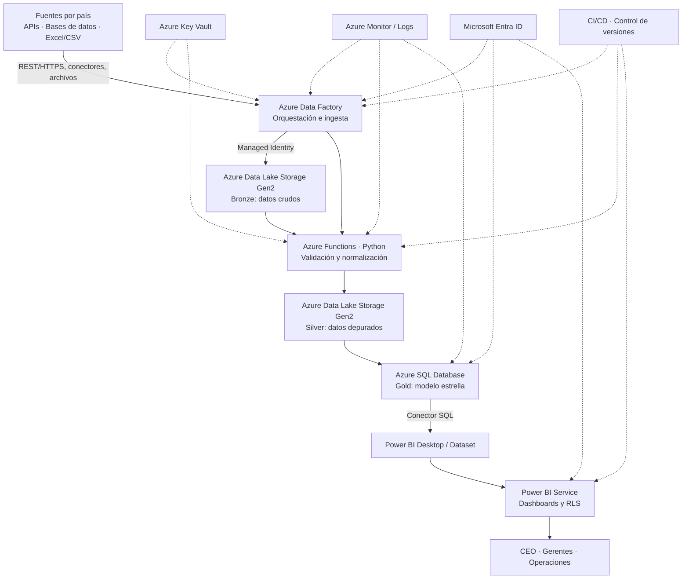

# VOLTIA EnergyView — Contexto integral y guía para construir un mock académico

> **Proyecto:** VOLTIA Energy Control Tower / Voltia EnergyView  
> **Nombre formal:** Torre de Control de Desempeño Energético Multipaís (Dashboard BI)  
> **Organización del caso:** VOLTIA Energía Renovable S.A.S.  
> **Tipo de solución:** Inteligencia de negocios (BI), integración y gobierno de datos, visualización ejecutiva y operativa.  
> **Alcance geográfico:** Colombia, Chile, Costa Rica y Uruguay.  
> **Uso de este documento:** contexto de producto + especificación de una demostración funcional con datos ficticios para presentar en clase.  
> **Versión del documento:** 1.0 — 25 de octubre de 2026.  

## 0. Cómo interpretar este documento

Se mezclan aquí **tres capas, identificadas expresamente**:

- **[PROYECTO]**: contexto, objetivos, límites y decisiones acordados en el trabajo académico y en la arquitectura V1.
- **[MOCK PROPUESTO]**: concreciones de UX, rutas, tecnologías y datos inventados para que otra persona o un asistente de programación pueda implementar una aplicación demostrable. No son compromisos previamente aprobados.
- **[SIMULACIÓN ACADÉMICA]**: cifras, porcentajes, alertas, operaciones, cronología adelantada y retornos económicos construidos para ejercicios y exposiciones; **no son datos reales de VOLTIA ni mediciones tomadas de Azure**.

**Fecha de referencia real del documento: 25/10/2026.** Algunos archivos de seguimiento del caso académico contienen cortes fechados **16/11/2026** y **22/01/2027**; son **escenarios futuros dentro del ejercicio**, no eventos ya ocurridos a la fecha de este documento. No confundir el avance del proyecto (porcentaje de tareas) con el desempeño energético (KPI de negocio).

---

## 1. Resumen ejecutivo del proyecto [PROYECTO]

VOLTIA es la organización del caso académico y desarrolla operaciones relacionadas con energía renovable, principalmente generación solar/eólica, consumo o gestión energética, movilidad eléctrica y resultados comerciales, con presencia en **Colombia, Chile, Costa Rica y Uruguay**.

La dirección no dispone de una visión consolidada, confiable y oportuna de sus activos y operaciones regionales. Cada país maneja fuentes de información, formatos, calendarios, monedas y estructuras diferentes. Los reportes están fragmentados, tardan en prepararse y dificultan comparar países y detectar problemas.

**Voltia EnergyView** es la propuesta de una **Torre de Control de Desempeño Energético Multipaís** que toma datos existentes, los integra, estandariza y transforma en indicadores comprensibles mediante tableros de Business Intelligence. La dirección obtiene una vista corporativa; cada gerente, una vista de su país; y las áreas operativas, detalle de sus activos.

**Frase de exposición:** “VOLTIA ya tiene información en sus diferentes operaciones; el problema no es producir más datos, sino unificarlos, hacerlos comparables y convertirlos en decisiones oportunas”.

### 1.1. Problema que resuelve

1. Datos aislados por país, área y sistema.
2. Distintas unidades de medida (kWh/MWh), monedas (COP/CLP/CRC/UYU), husos horarios y definiciones de KPI.
3. Consolidación manual con Excel y reportes desactualizados.
4. Dificultad para medir generación real frente a esperada, consumo, disponibilidad, utilización de estaciones y resultados comerciales.
5. Menor trazabilidad sobre el origen y actualización de las cifras.
6. Riesgo de mostrar a usuarios datos de países o activos fuera de su autorización.
7. Informes ambientales y regulatorios laboriosos, con definiciones que pueden variar por jurisdicción.

### 1.2. Objetivo general

Planificar y diseñar una solución BI que **consolide, normalice, analice y visualice indicadores clave de desempeño energético y comercial** de cuatro países, para respaldar la toma de decisiones estratégicas, gerenciales y operativas.

### 1.3. Objetivos específicos

- Levantar requisitos con dirección, responsables de país y áreas operativas.
- Definir y homologar los KPI y su método de cálculo.
- Inventariar fuentes de datos por país y tipo de activo.
- Diseñar la arquitectura de integración, almacenamiento, transformación, modelo analítico y visualización.
- Establecer calidad, seguridad, trazabilidad y controles de acceso.
- Crear tableros ejecutivos, comparativos y operacionales diferenciados por perfil.
- Probar un piloto en Colombia y plantear el escalamiento a Chile, Costa Rica y Uruguay.
- Preparar pruebas, despliegue, capacitación, documentación y aceptación.

### 1.4. Qué NO es

No es una aplicación de control en tiempo real de plantas, un SCADA, un sustituto de ERPs, un sistema nuevo de facturación, una plataforma de instalación de sensores ni un proyecto para reemplazar los sistemas actuales. **Recibe y analiza información de los sistemas fuente**. Aunque el planteamiento inicial habla de información “en tiempo real”, la V1 propuesta se basa en cargas y refrescos automatizados; **no se ha definido ni garantizado una transmisión de telemetría instantánea**.

---

## 2. Contexto académico y equipo [PROYECTO]

| Campo | Definición del caso |
|---|---|
| Grupo académico | Grupo 6 |
| Nombre del proyecto | VOLTIA Energy Control Tower / Voltia EnergyView |
| Organización | VOLTIA Energía Renovable S.A.S. |
| Área patrocinadora | Dirección General / Tecnología |
| Patrocinador | Wilson Munive Camargo, Director General |
| Líder del proyecto | Sharick de las Aguas Bertel |
| Analista de negocio y requerimientos | Justin Castro Pérez |
| Responsable técnico y de arquitectura | Mario Alberto Uparela Posada |
| Documentación y comunicaciones | Leonardo de Jesús Vergara Sánchez |
| Calidad y riesgos | Jesús David Rivera Coronado |
| Inicio de la línea base del ejercicio | 10/09/2026 |
| Duración programada | 6 meses |
| Presupuesto base autorizado del caso | USD 75.000 |
| Metodología | Híbrida: planificación/seguimiento predictivo y evolución iterativa de tableros |

**Rol de Mario:** definición y explicación de la arquitectura técnica, inventario y diagnóstico de fuentes, integración lógica de datos, criterios tecnológicos y acompañamiento de la cadena crítica **datos → KPI → dashboard → seguridad**. En el cronograma también se asignaron a Mario actividades relacionadas con desarrollo técnico.

Los recursos especialistas mencionados en planes de trabajo (integración de datos, desarrollo BI Power BI, infraestructura/seguridad) representan **roles de ejecución** y no necesariamente personas adicionales identificadas por nombre.

---

## 3. Usuarios y permisos [PROYECTO + MOCK PROPUESTO]

| Perfil | Necesidad | Visibilidad propuesta |
|---|---|---|
| Dirección General / CEO | Vista global, comparación y tendencias, decisiones de inversión y expansión | Todos los países y consolidados |
| Gerente de país | Seguimiento de metas y activos de su país | Solo su país |
| Operaciones / mantenimiento | Disponibilidad, incidencias, producción y utilización | País/activos asignados |
| Comercial | Ingresos, facturación, evolución comercial | País/activos asignados según permiso |
| Analista BI / Tecnología | Monitorear actualizaciones, calidad, fallas y trazabilidad | Acceso técnico autorizado |
| Auditor / lector | Consultar reportes aprobados | Solo lectura dentro de su ámbito |

**Regla central:** el usuario autenticado **no debe recibir** registros de países no autorizados. El selector de país **no sustituye** los permisos; el backend o Power BI RLS debe aplicar la restricción en los datos. No se deben filtrar datos sensibles solo desde el navegador.

Para un mock simple, se puede cambiar de perfil con un selector de **“Modo demostración”** claramente etiquetado; no debe presentarse como un sistema de autenticación real.

---

## 4. Áreas de negocio y preguntas que responde [PROYECTO]

| Dominio | Preguntas de negocio | Ejemplos de indicadores |
|---|---|---|
| Generación renovable | ¿Cuánto generamos? ¿Con qué tecnología? ¿Estamos cumpliendo la meta? | MWh generados, meta, desviación, potencia instalada, generación real vs. esperada |
| Consumo energético | ¿Dónde crece el consumo? ¿Cómo varía respecto del periodo anterior? | MWh consumidos, tendencia, consumo por país/activo |
| Movilidad eléctrica | ¿Cuánto se usa la red de carga? ¿Qué estaciones están subutilizadas? | Energía suministrada, número de sesiones, disponibilidad, utilización de cargadores |
| Desempeño comercial | ¿Qué país produce más ingresos? ¿Qué resultados se generan por línea? | Ingresos normalizados, variación mensual, cumplimiento comercial |
| Medioambiente | ¿Qué aportes ambientales estimamos? | Emisiones evitadas estimadas (tCO₂e), por país y tecnología |
| Confiabilidad de datos | ¿Cuándo llegaron los datos? ¿Hay duplicados o valores inválidos? | Actualización, completitud, validaciones, incidencias de calidad |
| Regulación/reportes | ¿Qué información se necesita consolidar según cada país? | Reportes descargables y campos de control por jurisdicción |

> Nota: los factores de emisiones, metas, reglas regulatorias y fórmulas contables oficiales requieren validación del negocio. En el mock, cualquier cifra correspondiente será **ejemplo ficticio**.

---

## 5. Catálogo inicial de KPI [PROYECTO + DEFINICIONES PARA MOCK]

Las siguientes fórmulas son una **propuesta didáctica consistente** para usar en la aplicación demostrativa. Las definiciones y umbrales finales deben validarse con el propietario del KPI.

| KPI | Fórmula / lógica propuesta | Unidad | Frecuencia de visualización mock |
|---|---|---|---|
| Generación renovable total | SUM(energía generada) | MWh | Diario/mensual |
| Generación solar | SUM(MWh donde tecnología = solar) | MWh | Mensual |
| Generación eólica | SUM(MWh donde tecnología = eólica) | MWh | Mensual |
| Generación esperada | SUM(meta o pronóstico del periodo) | MWh | Mensual |
| Cumplimiento generación | `generacion_real / generacion_esperada * 100` | % | Mensual |
| Desviación de generación | `(real - esperada) / esperada * 100` | % | Mensual |
| Capacidad instalada | SUM(potencia nominal de activos vigentes) | MW | Al corte |
| Consumo energético | SUM(energía consumida) | MWh | Diario/mensual |
| Energía de movilidad | SUM(kWh entregados en carga) / 1000 | MWh | Mensual |
| Sesiones de carga | COUNT(sesiones únicas) | sesiones | Mensual |
| Utilización cargadores | `horas_en_uso / horas_disponibles * 100` | % | Mensual |
| Disponibilidad | `horas_operativas / horas_totales_programadas * 100` | % | Mensual |
| Ingresos comerciales | SUM(ingresos convertidos a moneda corporativa) | USD | Mensual |
| Variación ingresos | `(ingreso_actual - ingreso_previo) / ingreso_previo * 100` | % | Mensual |
| Emisiones evitadas estimadas | SUM(MWh elegibles × factor de emisión del país/periodo) | tCO₂e | Mensual |
| Calidad de datos | `registros_válidos / registros_evaluados * 100` | % | Por carga |

### 5.1. Reglas obligatorias de consistencia

- **Unidades:** 1 MWh = 1.000 kWh. Unificar antes de sumar.
- **Monedas:** no sumar directamente COP, CLP, CRC y UYU. Convertir a USD con tasa, fecha de vigencia y registro de origen; mostrar la metodología.
- **Periodo:** estandarizar fechas y zonas horarias; almacenar el instante en UTC y derivar periodo local de negocio cuando corresponda.
- **Granularidad:** definir si un registro representa día, hora, sesión o factura. No sumar la misma magnitud dos veces por joins.
- **Trazabilidad:** conservar país, fuente, fecha de ingesta, versión/fecha del dato y resultado de validación.
- **Nulos/denominador cero:** exponer “N/D”; no calcular 0% artificialmente.
- **Emisiones evitadas:** estimación metodológica, no ahorro medido ni certificación ambiental.

---

## 6. Arquitectura de producción V1 definida [PROYECTO]

**Tecnologías objetivo acordadas: Microsoft Azure + Power BI.**



### 6.1. Explicación componente por componente — orden para exponer

1. **Fuentes multipaís.** Sistemas existentes de plantas solares/eólicas, medición de consumo, operadores de carga, aplicaciones comerciales y archivos locales. Entregan APIs REST, consultas a bases de datos o CSV/Excel. No se reemplazan.
2. **Azure Data Factory (ADF).** Programa y ejecuta extracciones, controla dependencias de tareas, reintentos y cargas, e ingresa los archivos/datos. Se conecta por HTTP(S), conectores DB y almacenamiento, según la fuente.
3. **ADLS Gen2 — Bronze.** Conserva copia de los registros **tal como llegaron** (raw), con ruta por fuente/país/fecha. Permite auditoría y reprocesamiento; no es la capa que consume el usuario final.
4. **Azure Functions (Python).** Revisa campos obligatorios, transforma unidades, normaliza códigos de país y tecnología, trata fechas y monedas, detecta duplicados y separa registros inválidos. Puede ser invocada/orquestada por ADF.
5. **ADLS Gen2 — Silver.** Guarda conjuntos limpios, homologados y validados, con reglas de calidad y trazabilidad. Los rechazados van a una zona `quarantine/` con motivo del rechazo.
6. **Azure SQL Database — Gold.** Construye tablas dimensionales y de hechos para consultas, cálculos e indicadores, evitando que Power BI dependa de archivos heterogéneos. La carga desde Silver a SQL debe ser explícita mediante jobs/pipelines.
7. **Power BI Desktop + Service.** Crea el modelo semántico, medidas DAX, filtros, páginas de dashboard, publicación y actualizaciones programadas. **Modo V1 propuesto: Import**, no DirectQuery ni streaming continuo como requisito.
8. **Microsoft Entra ID.** Autenticación de usuarios y servicios, y soporte a asignación de acceso.
9. **Power BI RLS.** Seguridad de filas para limitar los datos según país/perfil autorizado. Debe probarse con diferentes usuarios.
10. **Azure Key Vault.** Protege secretos, credenciales o certificados que requieran los conectores; preferir identidades administradas cuando sea viable.
11. **Azure Monitor / trazas.** Observa duración y fallas de pipelines, ejecuciones, alertas de calidad y estados de integración.
12. **CI/CD.** Versiona scripts, transformaciones, definición de pipelines y artefactos BI; separa ambientes **desarrollo** y **producción** en el diseño mínimo.

**Flujo de conexión resumido:** fuentes → ADF → Bronze → Functions → Silver → carga analítica → SQL Gold → Power BI → usuarios.

### 6.2. Consideraciones reales de la arquitectura

- ADF no “adivina” qué datos hay: requiere un conector y contrato de cada fuente.
- Bronze conserva originales; Silver homogeniza; Gold optimiza el consumo analítico.
- Azure Functions **no sustituye por sí sola** toda la orquestación de ADF.
- Una regla o fórmula de KPI debe tener definición de negocio, no solo código.
- La versión Import de Power BI se actualiza según frecuencia acordada; **no usar “tiempo real” como promesa técnica absoluta**.
- RLS limita filas en Power BI, pero no reemplaza la protección de SQL, ADLS, credenciales ni procesos.

---

## 7. Modelo de datos analítico [PROYECTO + PROPUESTA TÉCNICA]

### 7.1. Dimensiones

| Tabla | Columnas clave sugeridas | Descripción |
|---|---|---|
| `dim_pais` | `pais_id`, `codigo_iso`, `nombre`, `moneda_local`, `zona_horaria` | Contexto geográfico |
| `dim_fecha` | `fecha_id`, `fecha`, `anio`, `mes`, `nombre_mes`, `trimestre` | Calendario de análisis |
| `dim_activo` | `activo_id`, `pais_id`, `nombre`, `tipo`, `tecnologia`, `capacidad_mw`, `estado` | Plantas, puntos de consumo, estaciones |
| `dim_fuente_energetica` | `fuente_id`, `nombre`, `categoria` | Solar, eólica, red, etc. |
| `dim_moneda` | `moneda_id`, `codigo_iso`, `nombre` | Moneda original/corporativa |
| `dim_fuente_dato` | `fuente_dato_id`, `nombre`, `tipo`, `pais_id` | Origen técnico, para trazabilidad |

### 7.2. Hechos

| Tabla | Grano recomendado | Medidas |
|---|---|---|
| `fact_generacion` | activo + fecha + tecnología | `generacion_mwh`, `esperada_mwh`, `disponibilidad_horas` |
| `fact_consumo` | activo/punto + fecha | `consumo_mwh`, `costo_usd` opcional |
| `fact_movilidad` | estación + fecha (o sesión en detalle) | `energia_kwh`, `sesiones`, `horas_ocupadas`, `horas_disponibles` |
| `fact_comercial` | país + línea negocio + fecha | `ingresos_local`, `ingresos_usd`, `moneda`, `tipo_cambio_aplicado` |
| `fact_emisiones` | país/activo + fecha + metodología | `mwh_elegibles`, `factor_emision`, `tco2e_estimadas` |
| `fact_calidad_datos` | pipeline/fuente + ejecución | `evaluados`, `validos`, `invalidos`, `duplicados`, `fecha_ejecucion` |

### 7.3. Entidades complementarias para el mock

- `meta_kpi`: `id`, `pais_id`, `kpi`, `periodo`, `valor_objetivo`.
- `alerta`: `id`, `pais_id`, `activo_id?`, `tipo`, `severidad`, `titulo`, `descripcion`, `fecha`, `estado`.
- `usuario_demo`: `id`, `nombre`, `perfil`, `paises_permitidos`, `activos_permitidos?`.
- `etl_ejecucion`: `id`, `fuente`, `pais_id`, `inicio`, `fin`, `estado`, `registros`, `errores`.
- `tipo_cambio`: `fecha`, `moneda_origen`, `moneda_destino`, `tasa`, `fuente_referencia`.
- `avance_proyecto_demo`: elementos del cronograma **solo para la página académica de seguimiento**, separados de las tablas energéticas.

**Claves foráneas:** cada hecho debe enlazarse con sus dimensiones correspondientes. Para agregaciones, respetar el grano: una sesión de carga no debe duplicarse al unirla con facturas.

---

## 8. Dashboards previstos en la solución [PROYECTO]

1. **Vista ejecutiva global:** KPI consolidados, metas, alertas, tendencia corporativa, comparativo por país.
2. **Comparativo multipaís:** matriz Colombia/Chile/Costa Rica/Uruguay, ranking, cambios entre periodos, desglose por línea de negocio.
3. **Generación renovable:** solar vs. eólica, real vs. esperada, producción por planta/activo, disponibilidad.
4. **Consumo:** evolución temporal, distribución por país/activo, variaciones.
5. **Movilidad eléctrica:** estaciones, uso de infraestructura, energía suministrada, sesiones, disponibilidad.
6. **Comercial:** ingresos normalizados en USD, evolución y cumplimiento de metas por país.
7. **Calidad / operación de datos:** fuente, última carga, registros rechazados, pipelines y trazabilidad.
8. **Informes ambientales/regulatorios:** reportes adecuados por país y metodología (en el mock serán vistas/exportaciones ilustrativas, **no reportes oficiales**).

Un dashboard debe permitir como mínimo filtrar por **periodo** y por **país**. Según la vista, también por **tecnología** y **activo**.

---

# PARTE II — Especificación para crear un proyecto mock

## 9. Propósito del mock [MOCK PROPUESTO]

Construir una **web interactiva y navegable** que permita demostrar de principio a fin cómo se vería VOLTIA EnergyView sin requerir conexiones reales a operadoras eléctricas, APIs de países, infraestructura Azure activa ni licencias de Power BI para la exposición.

La maqueta debe:

- Verse como producto corporativo presentable, no como una página estática de métricas.
- Mostrar información **coherente** de los cuatro países.
- Tener filtros funcionales y gráficos que reaccionen a ellos.
- Simular cómo cambian permisos entre Director General y Gerente de País.
- Poder mostrar “alertas”, “calidad de datos” y el recorrido técnico de un dato.
- Incluir un panel académico opcional sobre avance del proyecto **75%**.
- Ser ejecutable localmente (sin depender de credenciales reales).

### 9.1. Alcance mínimo (MVP demostrable)

**Pantallas obligatorias:** `Visión general`, `Comparativo de países`, `Generación`, `Movilidad eléctrica`, `Calidad de datos`, `Arquitectura / Cómo funciona` y `Avance del proyecto` (académica).

**Pantallas secundarias recomendadas:** `Consumo`, `Comercial`, `Activos` y `Alertas`.

**Interacciones mínimas obligatorias:** seleccionar país, cambiar rango de fechas, filtrar tipo de fuente, hacer clic en un país para ver detalle, revisar una alerta, cambiar perfil de demostración, inspeccionar una fuente/carga y ver datos de muestra. Exportación CSV es deseable.

### 9.2. Fuera de alcance del mock

- Integraciones reales con sistemas industriales, SCADA, medidores o proveedores de carga.
- Provisionamiento obligatorio de Azure real.
- Power BI real o licencias si no están disponibles.
- Procesamiento de datos personales sensibles.
- Facturación/transacciones.
- Reportes regulatorios con validez jurídica.
- Autenticación de producción, identidades corporativas reales o permisos empresariales certificados.

---

## 10. Experiencia visual del mock [MOCK PROPUESTO]

**Dirección visual:** aplicación SaaS B2B para energía; diseño sobrio, claro y técnico, con lenguaje visual de operación corporativa.

- **Layout:** menú lateral con isotipo/nombre VOLTIA; cabecera con título, rango, país activo, perfil demo y sello `Datos simulados`.
- **Estética:** base neutra, verdes/azules moderados para categorías; usar rojo/ámbar exclusivamente para alertas o desviaciones. No depender solamente del color para comunicar estado.
- **Tipografía:** sans-serif legible; números con separadores consistentes.
- **Estados:** loading corto simulado opcional, vacío sin datos, KPI no disponible (`N/D`), error de fuente, alerta crítica y éxito.
- **Componentes:** tarjetas KPI con valor, unidad, delta y periodo; gráficos de líneas/columnas; tablas ordenables; chips de país/tecnología; tarjetas de alerta; modal/drawer de detalle.
- **Responsive:** prioridad escritorio para proyección en clase; adaptar a tablet y teléfono sin romper tablas.
- **Accesibilidad:** contraste correcto, texto alternativo, navegación por teclado, etiquetas de controles.

### 10.1. Navegación sugerida

| Ruta | Vista | Contenido principal |
|---|---|---|
| `/` | Resumen ejecutivo | MWh generados, cumplimiento, consumo, movilidad, ingresos, emisiones estimadas y tendencias |
| `/paises` | Comparativo | Tabla/ranking de los cuatro países, gráfico comparativo y detalle por país |
| `/generacion` | Generación | Solar/eólica, real vs. meta, plantas y disponibilidad |
| `/consumo` | Consumo | Tendencia y desglose |
| `/movilidad` | Movilidad | Red de carga, sesiones, utilización, activos más/menos usados |
| `/comercial` | Comercial | Ingresos en USD, variación, país y línea de negocio |
| `/activos` | Activos | Inventario, filtros, ficha individual, estado |
| `/alertas` | Alertas | Severidad, fecha, país, activo, estado y detalle |
| `/calidad` | Calidad de datos | Cargas, éxito/fallo, completitud, duplicados, cuarentena |
| `/arquitectura` | Arquitectura | Diagrama V1 y recorrido paso a paso |
| `/proyecto` | Seguimiento académico | 75% simulado, tareas/hitos/riesgos, roles y próximos pasos |

### 10.2. Composición recomendada de la pantalla principal

```text
┌─────────────────────────────────────────────────────────────────────┐
│ VOLTIA EnergyView  |  País: Todos  | Periodo: último año | CEO     │
│ DATOS SIMULADOS · Última actualización: fecha demostrativa          │
├─────────────────────────────────────────────────────────────────────┤
│ Generación      Cumplimiento       Consumo         Ingresos USD      │
│ [valor MWh]     [valor %]          [valor MWh]     [valor USD]       │
├─────────────────────────────────────────────────────────────────────┤
│ Generación real vs esperada     │ Mix de energía solar/eólica       │
│ [gráfico temporal]              │ [gráfico]                         │
├─────────────────────────────────┴───────────────────────────────────┤
│ Comparativo por país: Colombia | Chile | Costa Rica | Uruguay      │
│ [tabla con KPI y enlaces de detalle]                                │
├───────────────────────────────────┬─────────────────────────────────┤
│ Movilidad eléctrica               │ Alertas y calidad de datos       │
│ [sesiones, energía, utilización]  │ [lista por severidad]            │
└───────────────────────────────────┴─────────────────────────────────┘
```

---

## 11. Datos ficticios para la demostración [SIMULACIÓN ACADÉMICA]

**Importante:** no presentar estos registros como datos operacionales reales. Etiquetar la aplicación permanentemente como **“Datos simulados con fines académicos”**.

### 11.1. Plan de generación de datos

- **Países:** `CO` Colombia, `CL` Chile, `CR` Costa Rica, `UY` Uruguay.
- **Periodo inicial de visualización:** 12 meses consecutivos **anteriores o iguales a la fecha elegida en la demo** (no asumir que datos futuros son datos históricos reales).
- **Activos mock:** entre 5 y 8 por país; mezcla de plantas solares, eólicas y puntos de carga.
- **Generación:** series diarias o mensuales por planta. Debe existir coherencia entre energía real, meta y generación corporativa.
- **Movilidad:** mínimo 2 estaciones por país, con energía cargada, sesiones, horas disponibles y ocupadas.
- **Comercial:** ingresos en moneda local y USD equivalente; guardar tipo de cambio simulado.
- **Calidad:** al menos una carga exitosa, una con advertencia y una fallida para justificar la página de operación.
- **Alertas:** al menos una caída de disponibilidad, un activo por debajo de meta y una anomalía de fuente de datos.
- **Medioambiente:** factores de emisión **ficticios y rotulados**, aplicados a generación elegible y periodo.

### 11.2. Ejemplos de registros (no cifras reales)

```json
{
  "pais": "CO",
  "periodo": "2026-09",
  "generacion_mwh": 1250,
  "generacion_esperada_mwh": 1300,
  "consumo_mwh": 870,
  "energia_movilidad_mwh": 82,
  "sesiones_carga": 1750,
  "ingresos_usd": 164000,
  "factor_emision_tco2e_por_mwh": 0.15,
  "datos_simulados": true
}
```

De este ejemplo, el cumplimiento de generación es `1250/1300*100 = 96,15 %`; las emisiones evitadas hipotéticas serían `1250*0,15 = 187,5 tCO₂e` **si** toda la generación resultara elegible bajo una metodología ilustrativa. **No afirmar que el factor 0,15 es oficial de Colombia.**

### 11.3. Coherencia que debe cumplir el generador de semillas

- Total corporativo = suma de cada país (para medidas aditivas comparables).
- Generación por tecnología = suma por activos.
- Una variación porcentual se calcula desde los totales/series, **nunca sumando porcentajes individuales**.
- Los ingresos en USD se calculan a partir de cada ingreso local y su tipo de cambio simulado vigente.
- Utilización no puede superar 100% si no existe una razón documentada.
- Una alerta debe corresponder con los valores de KPI, fechas y país que muestra el dashboard.
- Las cifras de una tarjeta deben coincidir con la tabla exportada para los mismos filtros.
- Para el modo gerente de país, no hay valores corporativos agregados de otros países.

---

## 12. Funcionalidades detalladas del mock [MOCK PROPUESTO]

### 12.1. Tablero ejecutivo

**Filtros:** periodo, país, tecnología. **KPI:** generación, cumplimiento, consumo, energía de carga, ingresos, emisiones evitadas estimadas. **Gráficos:** tendencia mensual, real vs. esperado, solar/eólica, comparación por país. **Interacciones:** clic en país navega a su detalle; clic en alerta abre explicación.

### 12.2. Comparativo multipaís

**Tabla:** una fila por país con MWh generados, cumplimiento, consumo, MWh de carga, sesiones, ingresos USD y estado de calidad. **Gráficos:** barras por país, radar opcional únicamente si valores están normalizados (mejor evitar mezclar unidades). **Interacciones:** ordenamiento, comparativa de dos países, filtro temporal.

### 12.3. Generación y activos

**Tabla de plantas:** código, país, tecnología, capacidad MW, MWh reales, MWh esperados, cumplimiento, estado. **Detalle:** tendencia, principales desviaciones y fecha de último dato. **Interacciones:** seleccionar planta, tecnología y periodo.

### 12.4. Movilidad eléctrica

**KPI:** sesiones, energía entregada, estaciones activas, utilización y disponibilidad. **Tabla:** estaciones por país, horas ocupadas/disponibles, sesiones y alertas. **No se requiere un mapa**; puede agregarse si se dispone de coordenadas ficticias coherentes, pero no es necesario para el MVP.

### 12.5. Alertas

**Estados:** abierta, reconocida, resuelta. **Severidad:** informativa, advertencia, crítica. Al hacer clic mostrar causa, país, activo, timestamp, umbral hipotético, registro de origen y acción recomendada. Cambiar el estado puede almacenarse solo en memoria/local mock.

### 12.6. Calidad de datos

**Tabla de pipelines demo:** país, fuente, hora de ejecución, procesados, válidos, rechazados, estado. **Detalle de cuarentena:** ejemplo del registro, regla infringida, código de error y si fue reprocesado. **Acción “Simular recarga”:** solo actualiza estado/fecha ficticios y deja clara su naturaleza de simulación; no llamar a servicios Azure reales.

### 12.7. Arquitectura

Página didáctica con flujo interactivo **Fuentes → ADF → Bronze → Functions → Silver → SQL Gold → Power BI** y componentes transversales. Clic en una caja muestra para qué sirve, qué recibe, qué produce, cómo se conecta y qué validaciones requiere. Es una **representación del diseño V1**, no telemetría de recursos desplegados.

### 12.8. Seguimiento de proyecto (solo para clase)

Vista separada de operación energética: progreso global, barra de fase, tablero de tareas e hitos, riesgos y siguientes pasos. Su finalidad es demostrar avance académico, **no es un módulo núcleo de la Torre de Control operativa**.

---

## 13. Arquitectura de implementación del mock [MOCK PROPUESTO]

### 13.1. Opción recomendada: totalmente local, rápida y reproducible

- **Frontend:** React + Vite + TypeScript.
- **Estilos:** Tailwind CSS.
- **Gráficos:** Recharts o una librería equivalente de visualización.
- **Datos:** JSON/CSV semilla en `src/data/`, con funciones de agregación locales.
- **Estado/filtros:** React Context/Zustand (o estado simple, según tamaño).
- **Iconografía:** biblioteca de iconos SVG consistente.
- **Tablas:** componentes con filtros y ordenamiento.
- **Persistencia opcional:** `localStorage` solo para estados de demostración (por ejemplo, alertas reconocidas). No guardar información sensible.
- **Ejecución:** `npm install && npm run dev`, sin credenciales ni nube.

**Justificación:** para una exposición el valor es enseñar producto, datos, permisos simulados y recorrido de arquitectura; desplegar Azure sin fuentes reales añade coste y riesgo de fallos. **La arquitectura de producción permanece Azure + Power BI**, como se definió.

### 13.2. Alternativa si se desea un backend real

Laravel 10/11 API + PostgreSQL/SQLite + React. Útil para evidenciar endpoints, validaciones y seguridad backend, pero **no es obligatorio** para una demo de clase. Se deben marcar como **simulados** los endpoints que reemplazan a Power BI y Azure.

### 13.3. Mapeo producción vs. mock

| Producción V1 | Mock local | Qué demostrar |
|---|---|---|
| Sistemas fuente | Ficheros semilla CSV/JSON | Datos heterogéneos de cuatro países |
| ADF | Función `simulateIngestion()` | Orquestación y cargas |
| ADLS Bronze | Carpeta `data/raw` / estructura JSON original | Conservación del original |
| Azure Functions | Función `normalizeRecord()` | Normalización, deduplicación y rechazo |
| ADLS Silver | `data/normalized` | Datos homologados |
| SQL Gold | Dataset agregable/modelo de dominio local | Tablas limpias y dimensiones |
| Power BI | Pantallas React con gráficos | KPI y dashboards |
| Entra ID / RLS | Perfiles demo + filtrado simulado | Segregación conceptual |
| Monitor / Key Vault | Vista de ejecuciones y explicación didáctica | Observabilidad y gestión de credenciales conceptuales |

> **Nunca presentar las pantallas React como si fueran Power BI funcionando en Azure.** Se trata de un mock que representa la solución objetivo.

---

## 14. Estructura de repositorio sugerida [MOCK PROPUESTO]

```text
voltia-energyview-mock/
├── README.md
├── package.json
├── .env.example                  # Solo variables no secretas
├── public/
│   └── assets/                   # Logotipo original propio/permitido
├── src/
│   ├── app/                      # Rutas, layout y navegación
│   ├── components/
│   │   ├── layout/
│   │   ├── charts/
│   │   ├── kpis/
│   │   ├── tables/
│   │   └── filters/
│   ├── pages/
│   │   ├── ExecutiveOverview.tsx
│   │   ├── Countries.tsx
│   │   ├── Generation.tsx
│   │   ├── Consumption.tsx
│   │   ├── Mobility.tsx
│   │   ├── Commercial.tsx
│   │   ├── DataQuality.tsx
│   │   ├── Architecture.tsx
│   │   └── ProjectProgress.tsx
│   ├── data/
│   │   ├── raw/
│   │   ├── normalized/
│   │   ├── fixtures/
│   │   └── seeds.ts
│   ├── domain/
│   │   ├── types.ts
│   │   ├── kpi-calculations.ts
│   │   └── access-control.ts
│   ├── services/
│   │   ├── mock-api.ts
│   │   └── ingestion-simulator.ts
│   ├── hooks/
│   └── tests/
├── docs/
│   ├── architecture.md
│   ├── kpi-dictionary.md
│   ├── business-rules.md
│   └── demo-script.md
└── scripts/
    └── generate-seed-data.ts
```

Separar **datos, cálculos, componentes y vistas**: no hardcodear valores diferentes en cada tarjeta. Los componentes deben leer todos la misma capa de datos derivada.

---

## 15. Interfaces de datos y contratos mock [MOCK PROPUESTO]

### 15.1. Esquema TypeScript ilustrativo

```ts
type CountryCode = 'CO' | 'CL' | 'CR' | 'UY';
type EnergyTechnology = 'solar' | 'eolica';
type DemoRole = 'ceo' | 'country_manager' | 'operator' | 'analyst';

type Period = `${number}-${number}`; // YYYY-MM; validar formato real

interface GenerationRecord {
  id: string;
  country: CountryCode;
  assetId: string;
  technology: EnergyTechnology;
  period: Period;
  generationMWh: number;
  expectedMWh: number;
  sourceId: string;
  ingestedAt: string; // ISO 8601
}

interface MobilityRecord {
  id: string;
  country: CountryCode;
  stationId: string;
  period: Period;
  sessions: number;
  energyKWh: number;
  occupiedHours: number;
  availableHours: number;
}

interface DemoUser {
  id: string;
  name: string;
  role: DemoRole;
  allowedCountries: CountryCode[];
}
```

### 15.2. API propuesta si se usa backend (opcional)

| Método | Endpoint | Resultado |
|---|---|---|
| `GET` | `/api/demo/overview?country=CO&period=2026-09` | KPI y tendencia general |
| `GET` | `/api/demo/countries?period=2026-09` | Comparativo multipaís autorizado |
| `GET` | `/api/demo/generation?country=CL` | Hechos y plantas |
| `GET` | `/api/demo/mobility?country=CR` | Estaciones y sesiones agregadas |
| `GET` | `/api/demo/commercial?country=UY` | Ingresos en USD |
| `GET` | `/api/demo/alerts` | Alertas del alcance autorizado |
| `GET` | `/api/demo/data-quality` | Estado de cargas simuladas |
| `POST` | `/api/demo/reload` | Simular una ejecución ETL, sin Azure |
| `GET` | `/api/demo/project-progress` | Seguimiento académico del proyecto |

Si se implementa backend, asociar el país/perfil al usuario demo en servidor; **no confiar en `country=` como autorización**. Para el mock sin backend, admitir que el selector solo emula esa regla.

---

## 16. Historias de usuario y criterios de aceptación [MOCK PROPUESTO]

| ID | Historia de usuario | Criterio verificable |
|---|---|---|
| HU-01 | Como CEO quiero ver el consolidado corporativo | Presenta cuatro países y las KPI concuerdan con las sumas |
| HU-02 | Como CEO quiero comparar países | La matriz cambia al cambiar periodo y ordenamiento |
| HU-03 | Como gerente de país quiero ver solo mi país | Al cambiar a perfil gerente, no aparecen datos de otros países |
| HU-04 | Como operador quiero identificar plantas bajo meta | Listado con cumplimiento calculado, filtro por activos y alertas |
| HU-05 | Como responsable de movilidad quiero ver uso de cargadores | Sesiones, energía y utilización coinciden con registros de estaciones |
| HU-06 | Como dirección quiero analizar ingresos | Todos los importes consolidados están expresados en USD y señalan tipo de cambio simulado |
| HU-07 | Como analista quiero detectar datos defectuosos | Ver validaciones, registros rechazados y razón de rechazo |
| HU-08 | Como expositor quiero explicar la arquitectura | El diagrama permite recorrer fuente, ingesta, Bronze, transformación, Silver, Gold y BI |
| HU-09 | Como expositor quiero mostrar avance del proyecto | Vista de 75% con 66 actividades, hitos y tareas pendientes, marcada como simulación |
| HU-10 | Como usuario quiero exportar una tabla | El CSV respeta filtros y permisos del perfil demo |

### 16.1. Requisitos no funcionales mock

- Carga inicial cómoda para un computador de clase, sin esperas dependientes de red.
- Sin errores de consola ni rutas rotas en la demostración.
- Diseño legible a distancia en proyector de 1080p.
- Valores derivados programáticamente y recalculados con filtros.
- Todas las pantallas exhiben la procedencia simulada de los datos.
- Navegación usable sin requerir cuentas reales.
- Las simulaciones de fallos no bloquean la presentación.

---

## 17. Gestión de proyecto: contexto de cronograma y avance [PROYECTO / SIMULACIÓN]

La planificación académica incorpora **11 fases, 12 hitos y 66 actividades**, representadas también como **89 elementos** cuando se cuentan nodos agregadores (fases e hitos, además de actividades). Las tareas se han organizado en ClickUp con estados como:

- `PENDIENTE`
- `LEVANTANDO REQUERIMIENTOS`
- `EN PROGRESO`
- `COMPLETADO`
- `ENTREGADO Y SOCIALIZADO`

No debe afirmarse que una actividad está cerrada solo por el diseño del mock; el cronograma es la fuente de referencia para su estado.

### 17.1. Etapas del trabajo (síntesis funcional, no transcripción literal de las 11 fases)

1. Inicio, acta y alineación del sponsor.
2. Planeación de alcance, recursos, cronograma, presupuesto y riesgos.
3. Levantamiento de requerimientos, interesados y catálogo de KPI.
4. Inventario, diagnóstico y homologación de fuentes.
5. Diseño de arquitectura, herramientas, seguridad y modelo de datos.
6. Preparación de fuentes e integración piloto.
7. Normalización, calidad, conciliación y automatización.
8. Modelado analítico y cálculo de KPI.
9. Diseño/desarrollo de dashboards y seguridad de acceso.
10. Pruebas, aprobación del piloto y expansión a más países.
11. Capacitación, documentación, entrega y cierre.

Estas etapas sirven para **explicar el proceso**; para entregar el cronograma contractual debe usarse el archivo de 66 actividades y sus códigos reales.

### 17.2. Hitos referenciales conocidos

| Hito | Fecha del caso | Nota |
|---|---|---|
| HR01 — Recursos técnicos disponibles | 30/09/2026 | Referenciado en documentos de seguimiento |
| H02 — País piloto aprobado | 09/10/2026 | Piloto Colombia según escenario definido |
| H03 — Diseño integral aprobado | 26/10/2026 | Fecha de línea base del ejercicio; posterior a la fecha de este documento |
| H04 — Piloto funcional aceptado | 10/12/2026 | Hito planificado; no presentarlo como ocurrido el 25/10 |

### 17.3. Escenario de corte a ~50% (documentación con fecha futura)

El acta de seguimiento preparada para el **16/11/2026** contiene los siguientes números **como escenario del ejercicio**:

- Avance planificado: **50,18%**.
- Avance reportado: **50,02%**.
- Actividades: **30 completadas, 2 en proceso, 6 atrasadas y 28 sin iniciar** (66 total).
- **5 de 12** hitos completados en ese escenario.
- Estado general señalado como **amarillo** por riesgos y atrasos, aunque la diferencia porcentual global sea pequeña.
- Riesgos/cadena crítica: conciliación piloto (`A25`), actualización automática (`A26`), alertas calidad (`A27`), medidas KPI (`A33`), dashboard operativo (`A35`), seguridad (`A39`).

### 17.4. Escenario de presentación al 75%

En el trabajo académico se preparó una línea de avance de **75% con corte simulado al 22/01/2027**, para exponer lo completado y lo pendiente:

| Situación | Cantidad de actividades (escenario 75%) |
|---|---:|
| Completadas | 43 |
| En proceso | 3 |
| Atrasadas | 2 |
| Sin iniciar | 18 |
| **Total** | **66** |

**Logros narrativos del escenario 75%:** piloto Colombia aceptado dentro de la historia del proyecto; integración progresiva de Chile, Costa Rica y Uruguay; evolución desde arquitectura/piloto hasta ajustes de KPI, vistas multipaís, gobierno y seguridad. **Pendiente para el cierre:** conciliación final, estabilizar calidad y automatización, verificar reglas de acceso, completar indicadores/reportes regulatorios, pruebas finales, despliegue, capacitación y cierre formal.

> El porcentaje del 75% es una **foto del cronograma académico**, no significa que 75% de las fuentes energéticas reales estén integradas o que Azure ya esté provisionado.

### 17.5. Responsabilidad técnica de Mario en la exposición

**Ya trabajado/documentado en el relato del proyecto:** recursos técnicos, inventario y diagnóstico de fuentes, diseño de arquitectura de datos, propuesta Azure+Power BI, decisiones de integración y modelo general. **Seguimiento técnico esperado:** conciliación, construcción de flujos, validación de KPI, seguridad, despliegue y respaldo técnico al equipo. Algunas tareas especializadas se ejecutan por roles BI/integración/seguridad; Mario lidera o acompaña según el cronograma y no debe atribuirse el desarrollo individual de todas las actividades.

---

## 18. Presupuesto y retorno de inversión [PROYECTO / SIMULACIÓN]

El presupuesto de la línea base del ejercicio es **USD 75.000**. Hay un modelo financiero preliminar a 3 años con hipótesis que pueden mostrarse como ejemplo de justificación económica:

| Concepto | Valor del escenario |
|---|---:|
| Inversión inicial de la línea base | USD 75.000 |
| Costos recurrentes estimados (años 1–3) | USD 42.000 |
| Costos acumulados modelados | USD 117.000 |
| Beneficios proyectados acumulados | USD 149.058 |
| Beneficio neto proyectado | USD 32.058 |
| ROI proyectado simple | 27,4% |
| VPN proyectado, descuento 10% | USD 12.134 |
| TIR proyectada | 18,1% |

**Advertencia obligatoria:** inversión base y **estimaciones** no equivalen a gastos ejecutados ni beneficios realizados. Los beneficios, distribución del presupuesto, adopción (60% / 85% / 100% en años 1–3), costos recurrentes, TIR y VPN dependen de supuestos. La TRM de la calculadora es editable y sirve para mostrar USD/COP; no altera el ROI expresado en USD.

**Sugerencia de mock:** incluir un bloque “Caso de negocio (proyección)” solo en `/proyecto`, con esta nota de limitaciones. No mezclar ROI del proyecto con ingresos operativos de VOLTIA.

---

## 19. Pruebas demostrables [MOCK PROPUESTO]

**Prueba A — consistencia KPI:** seleccionar “Todos los países” y comparar total con la suma de 4 filas. Debe cuadrar.

**Prueba B — filtros:** seleccionar Chile y cambiar de mes; deben cambiar tanto gráficos como tarjetas y tablas, sin inconsistencias.

**Prueba C — permisos:** cambiar del modo CEO a Gerente Colombia; solo se ven registros de Colombia. Volver a CEO restaura los cuatro países.

**Prueba D — calidad:** mostrar un registro duplicado/fecha inválida, su motivo de rechazo y el resultado de normalización de otro registro con `kWh → MWh`.

**Prueba E — alertas:** seleccionar una planta por debajo del objetivo y comprobar que su desviación desencadena una alerta informativa coherente.

**Prueba F — movilidad:** mostrar sesiones y porcentaje de ocupación de una estación; poder identificar estaciones subutilizadas.

**Prueba G — proyecto:** navegar a `/proyecto`, explicar el avance 75% del escenario y diferenciar hitos restantes del estado operacional de los activos.

**Prueba H — arquitectura:** recorrer las siete capas principales y responder “qué recibe, qué procesa, qué entrega y quién lo usa” en cada una.

---

## 20. Guion sugerido para la exposición (6–8 minutos) [MOCK PROPUESTO]

**Min 0–1 — Problema.** “Voltia opera en cuatro países. Cada uno entrega información distinta. Esto obliga a consolidar reportes manualmente, dificulta comparar rendimiento y retrasa decisiones”.

**Min 1–2 — Solución.** Abrir `/` y mostrar la visión ejecutiva con filtros corporativos, generación y otros indicadores. Enfatizar que son **datos simulados**.

**Min 2–3 — Valor multipaís.** Abrir `/paises`, comparar los cuatro países y entrar al detalle de uno. Explicar que un gerente regional ve el consolidado y uno nacional solo su ámbito.

**Min 3–4 — Operación.** Abrir `/generacion` y `/movilidad`; mostrar un activo bajo meta, una alerta y el uso de puntos de carga.

**Min 4–5 — Confianza en los datos.** Abrir `/calidad` y explicar ingesta, normalización, trazabilidad, rechazo de duplicados y fecha de actualización.

**Min 5–6 — Arquitectura técnica.** Abrir `/arquitectura`: fuentes → ADF → Bronze → Functions → Silver → Azure SQL → Power BI. Explicar Entra ID, RLS, Key Vault y Monitor como servicios transversales.

**Min 6–7 — Gestión del proyecto.** Abrir `/proyecto`, explicar línea base y escenario 75%, qué se logró en el piloto y qué falta. Mencionar presupuesto base y que ROI es una proyección, si hay tiempo.

**Cierre.** “El mock demuestra la experiencia y los KPI con datos ficticios; el proyecto V1 propone Azure y Power BI como infraestructura y plataforma BI cuando existan las integraciones reales y las condiciones de puesta en producción”.

---

## 21. Orden recomendado de construcción del mock [MOCK PROPUESTO]

1. Crear proyecto web, layout, navegación y estilos.
2. Definir contratos TypeScript y datos semilla de cuatro países.
3. Programar funciones puras de cálculo de KPI (con tests básicos).
4. Construir filtros globales y control de ámbito por perfil demo.
5. Construir dashboard ejecutivo y comparativo multipaís.
6. Construir generación, movilidad, consumo y comercial.
7. Agregar alertas y calidad de datos coherentes con los registros.
8. Agregar página interactiva de arquitectura V1.
9. Agregar seguimiento 75% y escenario financiero, rotulados como simulación.
10. Ejecutar pruebas de consistencia, responsive, navegación y una pasada completa del guion de exposición.

**Criterio de “listo para clase”:** la demo corre localmente, no requiere internet, ningún KPI contradice sus tablas, los filtros funcionan, el perfil de país no ve datos ajenos, cada ruta esencial carga y el aviso **“Datos simulados con fines académicos”** permanece visible.

---

## 22. Prompt listo para pasar a un asistente de programación

> Crea una aplicación web académica llamada **Voltia EnergyView**, un mock interactivo de una Torre de Control de Desempeño Energético Multipaís para **Colombia, Chile, Costa Rica y Uruguay**. Usa **React, Vite, TypeScript, Tailwind y Recharts**. Toda la información será **simulada**, guardada en fixtures JSON/TS: no invoques Azure, Power BI ni servicios externos. Implementa un layout SaaS corporativo con sidebar, filtros de periodo/país/tecnología, switch de roles demo (CEO, gerente país, operador), vistas ejecutivo, comparativo, generación, consumo, movilidad eléctrica, comercial, alertas, calidad de datos, arquitectura y seguimiento académico del proyecto. Calcula los KPI desde registros comunes, sin valores aislados hardcodeados en tarjetas. Incluye resultados de generación real vs. esperada, consumo, sesiones de carga, utilización, ingresos normalizados a USD, emisiones evitadas estimadas (factor hipotético) y anomalías de calidad. Implementa demo RLS visual: cada gerente ve solo su país. Incorpora una vista explicativa de arquitectura objetivo **Fuentes → Azure Data Factory → ADLS Bronze → Azure Functions Python → ADLS Silver → Azure SQL Gold → Power BI**, más Entra ID, Key Vault, Monitor y CI/CD. Añade una página de **avance académico simulado 75%** con 66 actividades (43 completas, 3 en proceso, 2 atrasadas, 18 pendientes) y presupuesto USD 75.000, diferenciando este progreso del desempeño operativo. Muestra siempre el aviso **“Datos simulados con fines académicos”** y explícitamente indica que el mock web **representa**, pero no **implementa**, Azure ni Power BI. Debe ser navegable, responsive y usable en un proyector, con comandos de instalación y ejecución local. Consulta este Markdown como fuente de contexto y criterios de aceptación.

---

## 23. Vocabulario para sustentar la explicación

- **Torre de control:** vista centralizada para observar desempeño y actuar con información.
- **BI (Business Intelligence):** convertir datos en reportes e indicadores útiles para decisiones.
- **KPI:** indicador cuantificable de desempeño, con definición, fuente, fórmula y responsable.
- **ETL/ELT:** extracción, transformación y carga de datos entre sistemas.
- **Data Lake:** almacenamiento de datos crudos y depurados a escala.
- **Bronze / Silver / Gold:** capas de calidad y preparación progresivas.
- **Modelo estrella:** hechos numéricos conectados con dimensiones para análisis.
- **Power BI:** plataforma de visualización, modelado semántico, medidas y publicación de reportes.
- **RLS (Row-Level Security):** autorización que restringe filas visibles según el usuario.
- **Piloto:** primera implementación acotada para verificar valor, integración y aceptación antes de expandir.
- **Trazabilidad:** capacidad de conocer fuente y transformaciones de un dato.
- **Conciliación:** comprobación de concordancia entre origen y destino o sistemas distintos.
- **Desviación:** diferencia entre valor real y esperado, expresada en cantidad o porcentaje.
- **Meta:** valor objetivo aprobado para un KPI y periodo.
- **Mock:** simulación de la experiencia de producto sin dependencia obligatoria de sistemas productivos.

---

## 24. Fuentes internas usadas para esta consolidación

**Documentos del trabajo académico disponibles en el historial del proyecto:**

1. *VOLTIA Energía Renovable — Proyectos* (asignación académica y necesidad del Grupo 6).
2. *Acta de Constitución del Proyecto — VOLTIA Energy Control Tower*, versión 1.0, 19/08/2026 (organización, objetivos, interesados y alcance).
3. *Resumen Ejecutivo — VOLTIA Energy Control Tower* (problema, metas, entregables, riesgos y metodología).
4. *Cronograma_Voltia_EnergyView_Avance_75.xlsx* (referenciado previamente para el escenario académico al 75%; **el detalle de las 66 filas no se transcribe en este documento**).
5. *ACTA_SEGUIMIENTO_VOLTIA_ENERGYVIEW_16-11-2026* (referencia de seguimiento con **fecha futura respecto al 25/10/2026**, usada solo como escenario).
6. *Calculadora_ROI_Voltia_EnergyView_con_TRM.xlsx* y *Guion_Explicacion_ROI_Proyectado_Voltia_EnergyView* (modelo financiero simulado).
7. Decisiones del equipo en conversaciones del proyecto sobre **arquitectura V1 Azure + Power BI**, modelo dimensional, capas Bronze/Silver/Gold, permisos, roles y exposición.

**Limitaciones de la consolidación:** no es un volcado literal de todas las conversaciones ni de cada fila de ClickUp. La lista de fases está resumida funcionalmente y la implementación del mock es una propuesta nueva claramente identificada. El cronograma, presupuestos, fórmulas regulatorias y reglas de negocio tienen que validarse contra su documentación oficial antes de tratarse como especificaciones de producción.

---

## 25. Mensaje final que debe conservar el mock

> VOLTIA EnergyView propone unir datos energéticos, operativos y comerciales de cuatro países en una sola plataforma de análisis. La arquitectura objetivo es Azure + Power BI, con integración, validación, seguridad y tableros por perfil. La aplicación presentada en clase es un **mock funcional con datos simulados** para demostrar cómo se tomarían decisiones basadas en información consolidada, **no un despliegue productivo real**.
